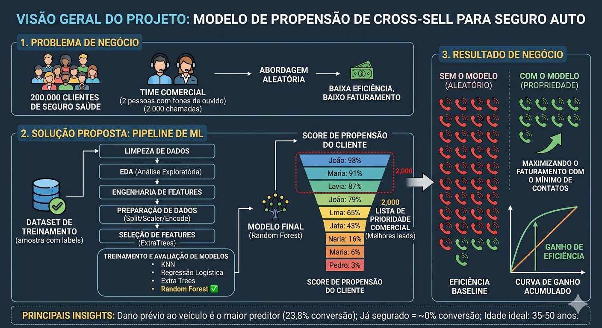

# 🏥 Health Insurance Cross-Sell — Propensity Score Ranking



## 📌 Business Problem

A health insurance company wants to expand into **car insurance** through a **cross-sell strategy**.

The company surveyed a small group of existing clients to understand their interest in purchasing car insurance. Based on this labeled dataset, the goal is to **rank ~200,000 clients by their likelihood to buy**, so the commercial team can prioritize their outreach.

**Business constraint:** The commercial team can only make **2,000 calls**. Calling randomly would be highly inefficient — a well-ranked list maximizes revenue within this capacity limit.

---

## 💡 Solution Strategy

> *"Don't classify — rank."*

Instead of predicting who will or won't buy, the model generates a **purchase probability** for each client. Clients are then sorted from most to least likely, and the team focuses calls on the top of the list.

Performance is evaluated via **Cumulative Gain** and **Lift curves**:
- **Gain curve**: "If I call X% of the base, I capture Y% of all interested clients."
- **Lift curve**: "My model is X times better than calling randomly."

---

## 🗂️ Project Structure

```
├── data/
│   └── raw/
│       └── train.csv           # Labeled dataset from Kaggle
├── notebooks/
│   └── 01-health_insurance_revised.ipynb   # Full pipeline notebook
├── src/
│   └── features/
│       ├── age_scaler.pkl                      # MinMaxScaler fitted on train
│       └── fe_policy_sales_channel_scaler.pkl  # Frequency encoding mapping
└── README.md
```

---

## 📊 Dataset

Source: [Kaggle — Health Insurance Cross Sell Prediction](https://www.kaggle.com/datasets/anmolkumar/health-insurance-cross-sell-prediction)

| Column | Description |
|---|---|
| `gender` | Client gender |
| `age` | Client age |
| `driving_license` | Whether the client has a driving license |
| `region_code` | Region where the client lives |
| `previously_insured` | Whether the client already has car insurance |
| `vehicle_age` | Age of the client's vehicle |
| `vehicle_damage` | Whether the client's vehicle was previously damaged |
| `annual_premium` | Annual health insurance premium paid |
| `policy_sales_channel` | Channel through which the client was contacted |
| `vintage` | Number of days as a customer |
| `response` | **Target** — 1 if interested in car insurance, 0 otherwise |

---

## 🔍 Key Insights from EDA

1. **Vehicle damage is the strongest predictor**: Clients with prior vehicle damage convert at 23.8% vs only 0.5% without.
2. **Already-insured clients show near-zero interest**: `previously_insured = 1` can be filtered out before calling, saving capacity.
3. **Sweet spot age range is 35–50 years**: ~21% conversion rate with good volume.
4. **Channel matters significantly**: Channels 26, 124 and 156 convert ~20%, while channels 152 and 160 convert less than 3%.
5. **Vehicle age 1–2 years has highest propensity**: 17.4% vs 4.4% for vehicles under 1 year.

---

## ⚙️ Pipeline

```
Raw Data
   ↓
Data Cleaning (dtype conversion, NaN check, column renaming)
   ↓
EDA (boxplots, histograms, countplots with conversion rates)
   ↓
Feature Engineering (drop low-power features, encode categoricals)
   ↓
Data Preparation (train/val/test split, MinMaxScaler, Frequency Encoding, One Hot Encoding)
   ↓
Feature Selection (ExtraTreesClassifier importance — Boruta was tested but discarded)
   ↓
Model Training (KNN, Logistic Regression, Extra Trees, Random Forest)
   ↓
Evaluation (Cumulative Gain + Lift curves on validation set)
   ↓
Final Model (Random Forest retrained on train+val, evaluated on test)
   ↓
Business Performance (ROI simulation by propensity bucket)
```

---

## 🤖 Models Evaluated

| Model | Notes |
|---|---|
| KNN | Baseline — sensitive to scale |
| Logistic Regression | Fast, interpretable, weaker ranking |
| Extra Trees | Strong performance, used also for feature selection |
| **Random Forest** ✅ | **Selected — best Gain/Lift on validation** |

---

## 📈 Feature Importance (ExtraTreesClassifier)

| Feature | Importance |
|---|---|
| `vehicle_damage` | 30.1% |
| `previously_insured` | 20.9% |
| `age` | 19.8% |
| `policy_sales_channel` | 18.7% |
| `vehicle_age_*` (3 columns) | ~10.2% |
| `gender` | 0.36% — **dropped** |

---

## 💰 Business Performance

Revenue simulation assumptions:
- **R$ 40** profit per successful sale
- **R$ 4** cost per call

Clients are grouped into propensity buckets (0.05 intervals). For each bucket, actual conversion rate, gross revenue, cost and net revenue are computed using real ground truth labels from the test set.

---

## 🛠️ Tech Stack

- **Python 3.11**
- **pandas**, **numpy**
- **scikit-learn** — preprocessing, models, train/test split
- **seaborn**, **matplotlib** — visualizations
- **pickle** — model/scaler persistence

---

## ▶️ How to Run

```bash
# 1. Clone the repo
git clone https://github.com/<your-username>/health-insurance-cross-sell.git
cd health-insurance-cross-sell

# 2. Create and activate virtual environment
pyenv virtualenv 3.11.0 health_insurance
pyenv local health_insurance

# 3. Install dependencies
pip install -r requirements.txt

# 4. Download the dataset from Kaggle and place it at:
#    data/raw/train.csv

# 5. Run the notebook
jupyter notebook notebooks/01-health_insurance_revised.ipynb
```

---

## 👤 Author
Made by **Matheus Ribeiro** — Data Science student.  
Feel free to connect on [LinkedIn](https://www.linkedin.com/in/matheusvlribeiro/) or check out other projects on [GitHub](https://github.com/matheusvlribeiro).
